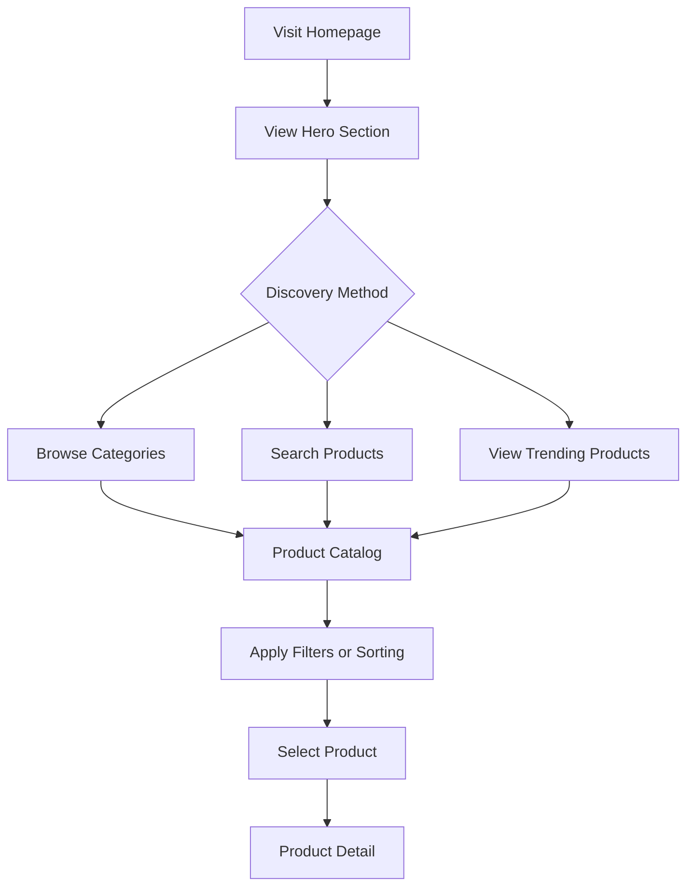
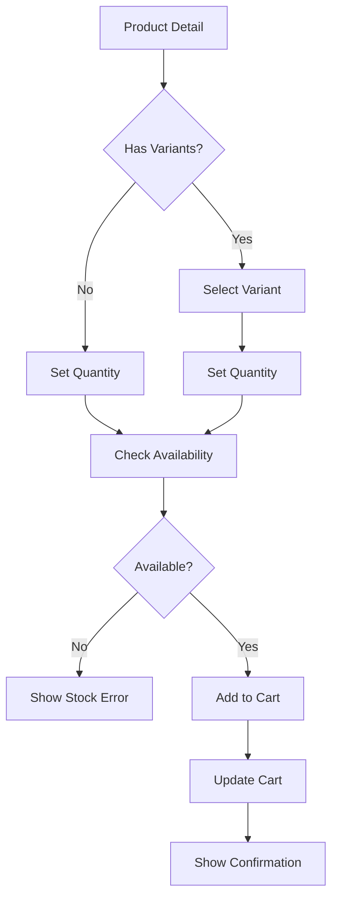
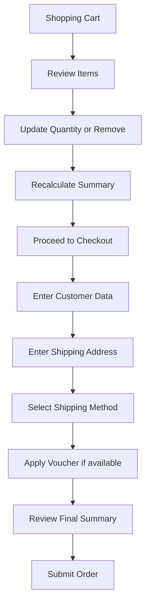
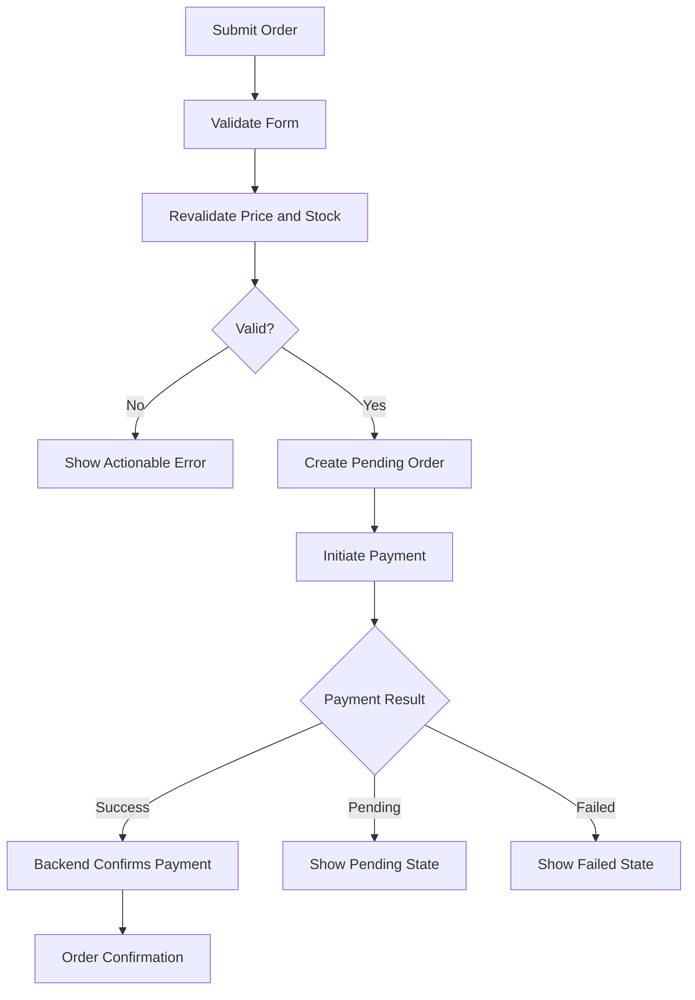
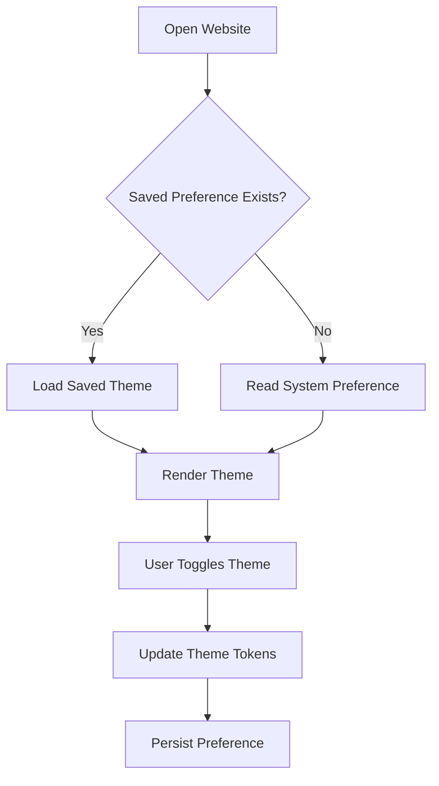
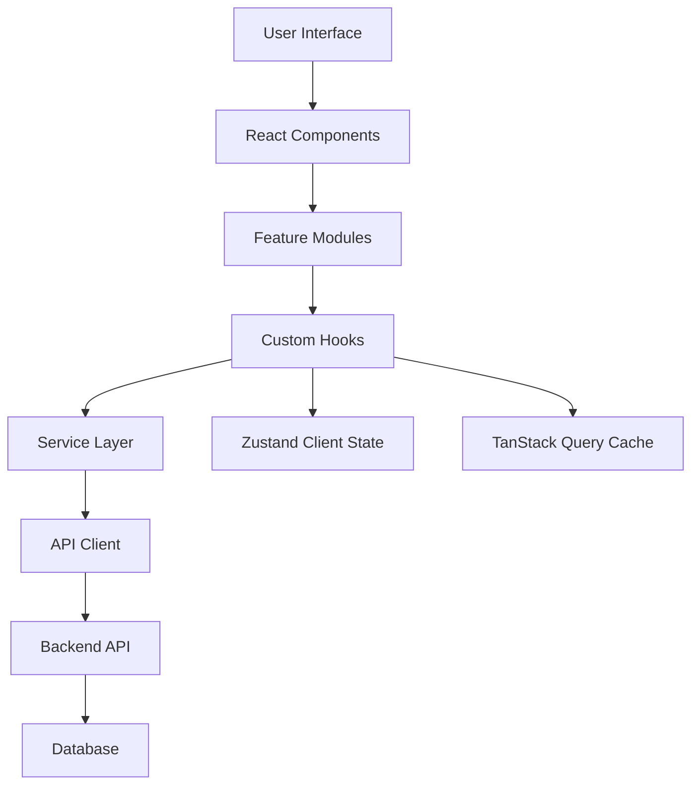
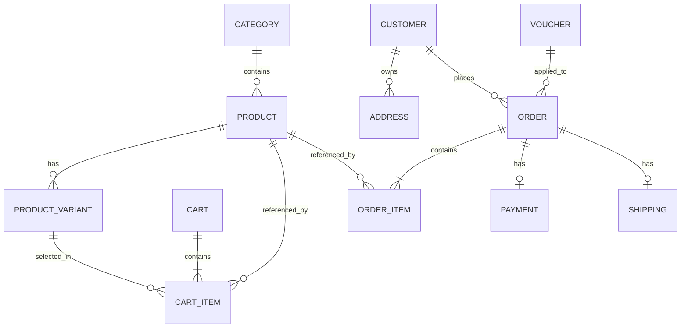
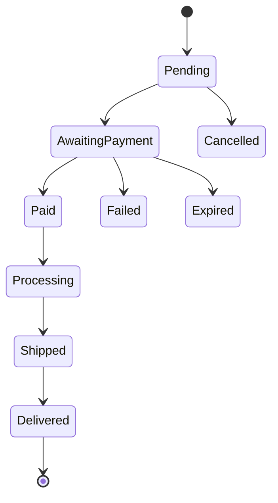

# Product Requirements Document (PRD)

# MayurienShop

**Tagline:** Little Things, Big Happiness!\
**Versi dokumen:** 1.0\
**Status:** Draft --- siap menjadi baseline pengembangan setelah open
questions dikonfirmasi\
**Product type:** E-commerce / Online Store\
**Bahasa:** Indonesia\
**Target platform:** Responsive web application

------------------------------------------------------------------------

## Document Control

  -----------------------------------------------------------------------
  Atribut                             Nilai
  ----------------------------------- -----------------------------------
  Product                             MayurienShop

  Dokumen                             Product Requirements Document

  Versi                               1.0

  Status                              Draft

  Pemilik keputusan produk            Product Owner / Business Owner

  Pengguna dokumen                    Product, Design, Frontend, Backend,
                                      QA, AI Coding Agent

  Baseline frontend                   React, TypeScript, Tailwind CSS

  Mata uang awal                      IDR (asumsi)
  -----------------------------------------------------------------------

### Cara menggunakan dokumen ini

Dokumen ini adalah baseline requirement. AI Coding Agent harus membaca
dokumen sebelum mengubah arsitektur atau mengimplementasikan fitur. Jika
ada konflik antara instruksi prompt baru dan requirement ini, agent
harus mengidentifikasi konflik dan meminta keputusan, bukan diam-diam
mengubah business rule. Semua keputusan yang mengubah scope, API
contract, data model, atau acceptance criteria harus dicatat sebagai
perubahan versi.

### Konvensi

-   **P0 --- Must have:** wajib untuk MVP.
-   **P1 --- Should have:** penting, tetapi MVP masih dapat diuji
    tanpanya jika disetujui Product Owner.
-   **P2 --- Could have:** enhancement setelah MVP.
-   Harga disimpan sebagai integer dalam satuan rupiah (IDR), bukan
    floating point.
-   Backend adalah sumber kebenaran untuk harga, stok, voucher, ongkir,
    order, dan status pembayaran.
-   Contoh data dan endpoint dalam dokumen ini adalah kontrak usulan,
    bukan bukti bahwa backend/provider sudah tersedia.

------------------------------------------------------------------------

# 1. Executive Summary

## 1.1 Product Overview

MayurienShop adalah toko online yang menjual alat tulis kantor (ATK),
stationery, cute accessories, gift items, dan lifestyle products yang
unik, aesthetic, playful, serta mengikuti tren. Website ditujukan
terutama kepada Gen Z, pelajar, mahasiswa, young professionals, dan
penggemar stationery.

MayurienShop bukan sekadar katalog ATK. Produk dipresentasikan sebagai
curated finds yang membantu aktivitas belajar, bekerja, journaling, dan
keseharian terasa lebih menyenangkan.

## 1.2 Product Vision

Menjadi destinasi online shopping pilihan bagi generasi muda untuk
menemukan produk-produk kecil yang memberi kebahagiaan dan membuat
aktivitas sehari-hari lebih menyenangkan.

## 1.3 Problem Statement

Target pengguna menghadapi beberapa hambatan: 1. Produk lucu dan
aesthetic tersebar di banyak marketplace dan akun sosial. 2. Pengguna
perlu waktu untuk menemukan produk sesuai kategori, gaya, atau
kebutuhan. 3. Informasi harga, varian, stok, dan detail produk di toko
kecil sering tidak konsisten. 4. Pengalaman toko online generik kurang
menciptakan identitas brand. 5. Checkout yang panjang atau tidak
transparan meningkatkan risiko pengguna meninggalkan keranjang.

## 1.4 Proposed Solution

MayurienShop menyediakan: - Homepage yang memperkenalkan brand dan
koleksi pilihan. - Katalog dengan search, category filter, price filter,
dan sorting. - Product detail dengan foto, deskripsi, varian, harga, dan
stok. - Shopping cart yang dapat diedit dan bertahan setelah refresh. -
Guest checkout dengan validasi yang jelas. - Integrasi payment dan
shipping melalui adapter yang dapat dikonfigurasi. - Visual identity
playful-minimalist dengan light mode dan dark mode. - Fondasi frontend
modular dan API contract yang dapat diimplementasikan backend.

## 1.5 Business Objectives and Initial KPIs

  ----------------------------------------------------------------------------------
  Objective        KPI                        Target awal Catatan pengukuran
  ---------------- ---------------- --------------------- --------------------------
  Meningkatkan     Product detail                   ≥ 20% Product detail views /
  product          CTR                                    product card impressions
  discovery                                               

  Mendorong        Add-to-cart rate                  ≥ 8% Sessions with add_to_cart
  add-to-cart                                             / product detail sessions

  Mengurangi       Checkout                         ≥ 50% Orders created / checkout
  friction         completion                             started
  checkout                                                

  Pengalaman       Mobile usability                  ≥ 90 Lighthouse/accessibility
  mobile           score                                  checks sebagai proxy

  Performa         Lighthouse                        ≥ 90 Target lab; validasi juga
                   Performance                            dengan field data

  Retensi          Returning              Baseline dahulu Tetapkan target setelah
                   visitors                               data 30 hari tersedia
  ----------------------------------------------------------------------------------

Target di atas adalah hipotesis awal, bukan capaian yang sudah terbukti.
Evaluasi setelah tersedia traffic dan analytics yang cukup.

------------------------------------------------------------------------

# 2. Product Strategy

## 2.1 Product Positioning

**Category:** Lifestyle & Stationery E-commerce.

**Positioning statement:**\
"MayurienShop adalah tempat menemukan cute and creative essentials yang
membuat meja belajar, ruang kerja, dan aktivitas sehari-hari terasa
lebih colorful."

## 2.2 Value Proposition

  -----------------------------------------------------------------------
  Value                               Penjelasan
  ----------------------------------- -----------------------------------
  Curated products                    Produk stationery dan accessories
                                      lucu dalam satu tempat

  Easy discovery                      Search, kategori, filter, dan
                                      sorting yang mudah dipahami

  Visual-first shopping               Foto produk menjadi elemen utama
                                      dalam discovery

  Transparent purchase                Harga, varian, stok, ongkir, dan
                                      total ditampilkan secara jelas

  Playful brand experience            Visual dan microcopy yang friendly
                                      tanpa mengganggu usability
  -----------------------------------------------------------------------

## 2.3 Target Audience

-   Gen Z, kira-kira usia 16--27 tahun.
-   Young adults, kira-kira usia 25--35 tahun.
-   Pelajar dan mahasiswa.
-   Young professionals.
-   Stationery enthusiasts.
-   Penggemar cute, aesthetic, dan trending accessories.

Rentang usia ini adalah segmentasi pemasaran awal, bukan pembatasan
akses website.

## 2.4 User Personas

### Persona A --- The Aesthetic Student

-   **Contoh nama:** Nadia, 20 tahun.
-   **Konteks:** Mahasiswa yang suka stationery aesthetic dan
    journaling.
-   **Goals:** Menemukan notebook, pens, sticky notes, dan desk
    accessories yang menarik.
-   **Pain points:** Pilihan tersebar; sulit membandingkan varian dan
    stok.
-   **Behavior:** Mobile-first, browsing berdasarkan visual dan
    kategori.
-   **Kebutuhan produk:** Kategori jelas, foto produk, harga, varian,
    stok, add-to-cart cepat.

### Persona B --- The Trend Hunter

-   **Contoh nama:** Alya, 23 tahun.
-   **Konteks:** Mengikuti produk viral dan suka membeli accessories
    unik.
-   **Goals:** Menemukan produk baru dan trending.
-   **Pain points:** Produk yang sedang ramai sulit ditemukan kembali.
-   **Behavior:** Discovery dari social media, browsing cepat, impulse
    purchase.
-   **Kebutuhan produk:** Trending section, new arrivals, product
    badges, search.

### Persona C --- The Practical Buyer

-   **Contoh nama:** Raka, 28 tahun.
-   **Konteks:** Young professional yang membeli perlengkapan meja
    kerja.
-   **Goals:** Membeli barang yang dibutuhkan secara cepat dan jelas.
-   **Pain points:** Informasi produk, stok, ongkir, dan total kadang
    tidak transparan.
-   **Behavior:** Search-driven, membandingkan harga, ingin checkout
    ringkas.
-   **Kebutuhan produk:** Search, spesifikasi, stok, cart yang mudah,
    checkout yang jelas.

## 2.5 User Needs

  -----------------------------------------------------------------------
  User need                           Product response
  ----------------------------------- -----------------------------------
  Menemukan produk                    Search dan category browsing

  Mempersempit pilihan                Filter kategori dan harga

  Membandingkan produk                Informasi dan foto product detail

  Memastikan ketersediaan             Stock status dan validasi ulang

  Mengelola pembelian                 Cart item, quantity, remove

  Mengetahui biaya akhir              Order summary termasuk ongkir dan
                                      biaya tambahan

  Menggunakan website dengan nyaman   Responsive layout, accessibility,
                                      theme toggle
  -----------------------------------------------------------------------

## 2.6 Success Metrics and Event Tracking

Funnel utama:
`Homepage → Product View → Add to Cart → Begin Checkout → Order Created → Payment Confirmed`

Event minimum: - `page_view` - `view_item_list` - `select_item` -
`view_item` - `search` - `filter_products` - `sort_products` -
`add_to_cart` - `remove_from_cart` - `begin_checkout` -
`apply_voucher` - `purchase` (hanya setelah status transaksi yang
ditentukan backend benar-benar confirmed)

Setiap event purchase harus memiliki order ID yang unik dan tidak boleh
dihitung ulang akibat refresh halaman confirmation.

------------------------------------------------------------------------

# 3. Product Scope

## 3.1 In-Scope MVP

  Feature                      Priority   Notes
  ---------------------------- ---------- ----------------------------------------------
  Homepage                     P0         Brand intro, categories, product sections
  Product catalog              P0         Grid, search, category/price filter, sorting
  Product detail               P0         Gallery, description, price, stock, variants
  Shopping cart                P0         Add, update quantity, remove, subtotal
  Guest checkout               P0         Customer and shipping details
  Order summary                P0         Server-calculated amount
  Order creation contract      P0         Requires backend
  Theme toggle                 P0         Light/dark and persistence
  Responsive behavior          P0         Mobile-first
  Loading/error/empty states   P0         All main data flows
  Basic SEO metadata           P1         Title, description, canonical strategy
  Wishlist                     P1         Can be postponed
  Product reviews              P2         Requires moderation/data model
  Newsletter                   P2         Requires email service/consent handling

## 3.2 Out of Scope MVP

-   Multi-vendor marketplace.
-   Seller onboarding and seller dashboard.
-   Loyalty points and membership tiers.
-   Affiliate system.
-   AI recommendation engine.
-   Live chat.
-   Subscription commerce.
-   Native Android/iOS applications.
-   Advanced warehouse and inventory forecasting.
-   Automated marketing campaign platform.

## 3.3 MVP Definition

MVP harus memungkinkan pengguna: 1. Membuka homepage. 2. Menjelajahi
katalog. 3. Mencari dan memfilter produk. 4. Membuka detail produk. 5.
Memilih varian jika tersedia. 6. Menambahkan produk ke cart. 7. Mengubah
quantity dan menghapus item. 8. Mengisi checkout. 9. Melihat order
confirmation dengan status yang berasal dari backend.

**Batasan penting:** frontend yang memakai mock data hanya membuktikan
prototype atau frontend MVP. Transaksi production memerlukan backend,
database, inventory validation, payment integration, shipping
calculation, dan verifikasi status pembayaran.

## 3.4 Future Enhancements

-   Customer account dan order history.
-   Wishlist lintas perangkat.
-   Product reviews dan ratings.
-   Voucher campaign management.
-   Product recommendation.
-   Admin dashboard untuk product/category/inventory.
-   Shipping tracking.
-   Abandoned cart recovery.
-   Loyalty program.
-   Multi-language jika ekspansi pasar dibutuhkan.

------------------------------------------------------------------------

# 4. Information Architecture

## 4.1 Sitemap

``` text
MayurienShop
├── Home (/)
├── Shop (/shop)
│   ├── All Products
│   ├── Category filter
│   └── Search results
├── Product Detail (/products/:slug)
├── Shopping Cart (/cart)
├── Checkout (/checkout)
├── Order Confirmation (/orders/:orderId/success)
├── About (/about)
├── Contact (/contact)
└── Legal
    ├── Privacy Policy
    ├── Terms & Conditions
    └── Shipping & Returns
```

## 4.2 Navigation Structure

### Desktop

-   Brand logo.
-   Home.
-   Shop.
-   Categories dropdown.
-   Search field.
-   Theme toggle.
-   Cart icon dengan item count.

### Mobile

-   Logo.
-   Search icon atau compact search.
-   Cart icon.
-   Hamburger menu.
-   Navigation drawer.
-   Filter dan sort menggunakan drawer/bottom sheet.

## 4.3 Page Hierarchy

  ----------------------------------------------------------------------------
  Page                    Route                        Access
  ----------------------- ---------------------------- -----------------------
  Homepage                `/`                          Public

  Catalog                 `/shop`                      Public

  Product detail          `/products/:slug`            Public

  Cart                    `/cart`                      Public

  Checkout                `/checkout`                  Public

  Order success           `/orders/:orderId/success`   Order-scoped; jangan
                                                       expose data pribadi
                                                       melalui ID yang mudah
                                                       ditebak
  ----------------------------------------------------------------------------

Guest checkout diasumsikan untuk MVP. Jika order lookup dibutuhkan,
gunakan opaque identifier atau token akses yang aman.

------------------------------------------------------------------------

# 5. User Journey & User Flows

## 5.1 Homepage to Product Discovery



## 5.2 Product Selection to Cart



## 5.3 Cart to Checkout



## 5.4 Checkout to Order Confirmation



## 5.5 Theme Switching



------------------------------------------------------------------------

# 6. Functional Requirements

## 6.1 Homepage

  ------------------------------------------------------------------------------
  ID             Feature        Description       Priority       Acceptance
                                                                 Criteria
  -------------- -------------- ----------------- -------------- ---------------
  FR-HOM-001     Announcement   Menampilkan pesan P0             Bar tampil di
                 bar            promo/informasi                  atas header;
                                toko                             dapat
                                                                 disembunyikan
                                                                 jika
                                                                 konfigurasi
                                                                 mengizinkan

  FR-HOM-002     Header         Navigasi utama    P0             Logo, shop,
                                                                 search, theme
                                                                 toggle, cart
                                                                 tersedia dan
                                                                 berfungsi

  FR-HOM-003     Hero section   Menjelaskan brand P0             Headline,
                                dan mengarahkan                  supporting
                                ke shop                          text, visual,
                                                                 dan CTA tampil;
                                                                 CTA membuka
                                                                 `/shop`

  FR-HOM-004     Featured       Menampilkan       P0             Klik kategori
                 categories     kategori pilihan                 membuka catalog
                                                                 dengan category
                                                                 query yang
                                                                 sesuai

  FR-HOM-005     Trending       Menampilkan       P0             Hanya produk
                 products       produk bertanda                  aktif yang
                                trending                         ditampilkan

  FR-HOM-006     Best sellers   Menampilkan       P1             Sorting
                                produk                           menggunakan
                                berdasarkan data                 metrik backend,
                                penjualan                        bukan urutan
                                                                 hardcoded

  FR-HOM-007     New arrivals   Menampilkan       P1             Urutan
                                produk terbaru                   berdasarkan
                                                                 `createdAt`
                                                                 terbaru

  FR-HOM-008     Newsletter     Form email        P2             Email
                                subscription                     divalidasi;
                                                                 consent dan
                                                                 status submit
                                                                 ditampilkan
  ------------------------------------------------------------------------------

## 6.2 Product Catalog

  -------------------------------------------------------------------------------------
  ID             Feature           Description    Priority       Acceptance Criteria
  -------------- ----------------- -------------- -------------- ----------------------
  FR-CAT-001     Product grid      Menampilkan    P0             Grid 2 kolom mobile, 3
                                   product cards                 tablet, 4 desktop pada
                                                                 container standar

  FR-CAT-002     Search            Mencari        P0             Submit keyword
                                   berdasarkan                   memperbarui hasil dan
                                   nama dan                      URL query
                                   keyword yang                  
                                   didukung API                  

  FR-CAT-003     Category filter   Filter         P0             Hanya produk kategori
                                   kategori                      terpilih yang
                                                                 ditampilkan

  FR-CAT-004     Price filter      Filter minimum P0             Nilai invalid ditolak;
                                   dan maksimum                  hasil memenuhi rentang
                                   harga                         

  FR-CAT-005     Sorting           Harga,         P0             Urutan sesuai pilihan;
                                   popularitas,                  default sort
                                   terbaru                       terdokumentasi

  FR-CAT-006     Product card      Informasi      P0             Nama, harga, gambar,
                                   ringkas produk                dan availability
                                                                 tampil

  FR-CAT-007     Discount badge    Menunjukkan    P1             Badge hanya muncul
                                   diskon valid                  jika compare-at price
                                                                 lebih besar dari
                                                                 selling price

  FR-CAT-008     Pagination/load   Memuat hasil   P1             Tidak ada duplikasi
                 more              bertahap                      item; loading dan
                                                                 error state tersedia

  FR-CAT-009     Empty result      Menangani      P0             Pesan dan tombol reset
                                   hasil kosong                  filter/search tampil

  FR-CAT-010     Filter            Menyimpan      P1             Refresh/back-forward
                 persistence       filter dalam                  mempertahankan filter
                                   URL                           yang direpresentasikan
                                                                 di URL
  -------------------------------------------------------------------------------------

## 6.3 Product Detail

  -----------------------------------------------------------------------------------
  ID             Feature        Description          Priority       Acceptance
                                                                    Criteria
  -------------- -------------- -------------------- -------------- -----------------
  FR-PDP-001     Image gallery  Galeri foto produk   P0             Thumbnail
                                                                    mengubah gambar
                                                                    utama; gambar
                                                                    memiliki alt text

  FR-PDP-002     Product        Nama, deskripsi,     P0             Data sesuai API;
                 information    harga                               tidak ada
                                                                    placeholder
                                                                    ketika data
                                                                    tersedia

  FR-PDP-003     Variant        Memilih varian       P0             Varian wajib
                 selector                                           dipilih jika
                                                                    produk memiliki
                                                                    varian

  FR-PDP-004     Stock status   Menunjukkan          P0             Stock 0
                                ketersediaan                        menampilkan sold
                                                                    out dan
                                                                    menonaktifkan
                                                                    pembelian

  FR-PDP-005     Quantity       Mengatur jumlah      P0             Minimum 1;
                 selector                                           maksimum tidak
                                                                    melebihi
                                                                    stok/limit

  FR-PDP-006     Add to cart    Menambahkan item     P0             Cart menyimpan
                                                                    product/variant
                                                                    yang benar;
                                                                    feedback tampil

  FR-PDP-007     Buy now        Add item lalu menuju P1             Item tervalidasi
                                checkout                            dan checkout
                                                                    hanya dapat
                                                                    dibuka jika cart
                                                                    valid

  FR-PDP-008     Related        Produk terkait       P2             Hanya produk
                 products                                           aktif dan bukan
                                                                    produk yang
                                                                    sedang dilihat

  FR-PDP-009     Missing        Produk tidak         P0             Tampilkan
                 product        ditemukan/nonaktif                  not-found state
                                                                    dan link kembali
                                                                    ke shop
  -----------------------------------------------------------------------------------

## 6.4 Shopping Cart

  ----------------------------------------------------------------------------
  ID             Feature        Description     Priority       Acceptance
                                                               Criteria
  -------------- -------------- --------------- -------------- ---------------
  FR-CART-001    Cart list      Daftar item     P0             Setiap item
                                                               menampilkan
                                                               thumbnail,
                                                               nama, varian,
                                                               harga,
                                                               quantity, line
                                                               total

  FR-CART-002    Quantity       Mengubah        P0             Subtotal
                 update         quantity                       diperbarui;
                                                               quantity di
                                                               bawah 1 ditolak

  FR-CART-003    Remove item    Menghapus item  P0             Item hilang dan
                                                               total
                                                               diperbarui

  FR-CART-004    Subtotal       Menghitung      P0             Subtotal sama
                                jumlah item                    dengan
                                                               penjumlahan
                                                               line total

  FR-CART-005    Empty state    Tampilan cart   P0             CTA menuju
                                kosong                         `/shop`;
                                                               checkout
                                                               dinonaktifkan

  FR-CART-006    Cart           Persistensi     P0             Cart bertahan
                 persistence    cart guest                     setelah refresh
                                                               pada browser
                                                               yang sama

  FR-CART-007    Checkout CTA   Lanjut checkout P0             Hanya aktif
                                                               ketika cart
                                                               berisi item
                                                               valid

  FR-CART-008    Stale cart     Menangani       P0             User diberi
                 handling       produk/varian                  tahu jika
                                berubah                        produk
                                                               nonaktif, harga
                                                               berubah, atau
                                                               stok berkurang
  ----------------------------------------------------------------------------

## 6.5 Checkout

  ---------------------------------------------------------------------------------
  ID             Feature        Description    Priority       Acceptance Criteria
  -------------- -------------- -------------- -------------- ---------------------
  FR-CHK-001     Customer       Form identitas P0             Nama, email, dan
                 information    customer                      telepon divalidasi
                                                              sebelum submit

  FR-CHK-002     Shipping       Form alamat    P0             Alamat, provinsi,
                 address                                      kota, kecamatan, dan
                                                              kode pos divalidasi
                                                              sesuai kebutuhan
                                                              provider

  FR-CHK-003     Shipping       Pilihan        P0             Hanya metode
                 method         pengiriman                    aktif/tersedia
                                                              ditampilkan

  FR-CHK-004     Voucher        Kode diskon    P1             Voucher divalidasi
                                                              backend;
                                                              invalid/expired
                                                              menampilkan alasan

  FR-CHK-005     Payment method Metode         P0             Hanya metode aktif
                                pembayaran                    dari
                                                              konfigurasi/backend
                                                              ditampilkan

  FR-CHK-006     Order summary  Rincian biaya  P0             Subtotal, discount,
                                                              shipping, fee, total
                                                              konsisten dengan
                                                              response backend

  FR-CHK-007     Order          Membuat order  P0             Double submit
                 submission                                   dicegah; idempotency
                                                              key digunakan pada
                                                              backend

  FR-CHK-008     Order          Status order   P0             Order number dan
                 confirmation                                 status berasal dari
                                                              backend

  FR-CHK-009     Payment        Penanganan     P0             Error tampil; retry
                 failure        gagal                         hanya tersedia jika
                                                              payment flow
                                                              mendukung

  FR-CHK-010     Pending        Penanganan     P0             UI tidak mengklaim
                 payment        pembayaran                    paid sebelum
                                tertunda                      konfirmasi backend

  FR-CHK-011     Price/stock    Validasi       P0             Perubahan harga/stok
                 revalidation   terakhir                      menghentikan submit
                                                              dan meminta user
                                                              meninjau ulang
  ---------------------------------------------------------------------------------

## 6.6 Global Features

  ----------------------------------------------------------------------------------------------
  ID             Feature         Description             Priority       Acceptance Criteria
  -------------- --------------- ----------------------- -------------- ------------------------
  FR-GLB-001     Theme toggle    Mengganti light/dark    P0             Seluruh halaman dan
                                                                        komponen menggunakan
                                                                        token tema aktif

  FR-GLB-002     Theme           Menyimpan preferensi    P0             Preferensi bertahan
                 persistence                                            setelah refresh

  FR-GLB-003     System          Mengikuti OS pada       P0             Jika belum ada
                 preference      kunjungan pertama                      preference tersimpan,
                                                                        theme mengikuti
                                                                        `prefers-color-scheme`

  FR-GLB-004     Responsive      Mobile/tablet/desktop   P0             Tidak ada horizontal
                 layout                                                 overflow pada viewport
                                                                        yang didukung

  FR-GLB-005     Toast           Feedback aksi           P0             Pesan sukses/gagal
                 notifications                                          tampil dan tidak
                                                                        menutupi kontrol penting

  FR-GLB-006     Loading         Feedback loading        P0             Skeleton tampil pada
                 skeleton                                               area data yang sedang
                                                                        dimuat

  FR-GLB-007     Error boundary  Menangani UI runtime    P1             Error terisolasi; user
                                 error                                  mendapat fallback dan
                                                                        opsi recovery

  FR-GLB-008     Accessible      Keyboard support        P0             Navigasi utama dan
                 navigation                                             kontrol penting dapat
                                                                        digunakan dengan
                                                                        keyboard
  ----------------------------------------------------------------------------------------------

------------------------------------------------------------------------

# 7. Page-by-Page UI/UX Specifications

## 7.1 Shared Layout and Visual Hierarchy

Semua halaman menggunakan: - Container dengan max-width konsisten. -
Header dan footer shared. - Spacing scale berbasis 4px. - Heading
hierarchy yang konsisten. - Focus state yang terlihat. - Semantic color
tokens untuk light/dark. - Product imagery sebagai fokus utama pada
halaman discovery.

## 7.2 Homepage

### Objective

Memperkenalkan brand, mengkomunikasikan value proposition, dan
mengarahkan pengguna ke product discovery.

### Layout order

1.  Announcement bar.
2.  Main header.
3.  Hero section.
4.  Featured categories.
5.  Trending products.
6.  Promotional banner.
7.  New arrivals.
8.  Brand introduction.
9.  Newsletter (future/P2).
10. Footer.

### Suggested copy

-   Headline: **"Make Every Little Thing More Fun!"**
-   Supporting text: "Temukan stationery dan accessories gemas yang
    bikin hari-harimu makin colorful."
-   Primary CTA: "Explore Collection"
-   Secondary CTA: "See What's Trending"

### Interactions

-   CTA hero membuka `/shop`.
-   Category card membuka catalog dengan category filter.
-   Product card membuka product detail.
-   Cart icon membuka `/cart`.
-   Theme toggle mengubah tema global.

### Responsive behavior

  -----------------------------------------------------------------------
  Viewport                            Behavior
  ----------------------------------- -----------------------------------
  Mobile \<768px                      Hero stacked; satu kolom; category
                                      horizontal scroll atau 2-column
                                      grid; product grid 2 kolom

  Tablet 768--1024px                  Hero 2 kolom jika ruang cukup;
                                      product grid 3 kolom

  Desktop \>1024px                    Hero asymmetric 2 kolom; product
                                      grid 4 kolom
  -----------------------------------------------------------------------

### Theme appearance

-   **Light:** white/soft neutral background, dark text,
    purple/pink/yellow/blue accents.
-   **Dark:** charcoal background, soft light text, subdued pastel
    accents, border yang cukup terlihat.

### States

-   Loading: skeleton untuk kategori dan product sections.
-   Empty: sembunyikan section opsional yang kosong atau tampilkan
    fallback editorial yang disetujui.
-   Error: tampilkan retry pada section data; jangan blank seluruh
    homepage.
-   Default: section tampil sesuai data aktif.

## 7.3 Product Catalog

### Objective

Membantu pengguna menemukan produk dengan cepat melalui search, filter,
dan sorting.

### Layout

-   Breadcrumb.
-   Page title dan result count.
-   Search.
-   Filter sidebar di desktop; drawer/bottom sheet di mobile.
-   Sorting control.
-   Active filter chips dan clear all.
-   Product grid.
-   Pagination/load more.

### Product card

-   Image ratio 1:1.
-   Nama maksimal dua baris sebelum truncate.
-   Harga jelas dan mudah dipindai.
-   Compare-at price dicoret hanya jika diskon valid.
-   Badge trending/new/discount hanya jika data mendukung.
-   Wishlist hanya jika feature aktif.
-   Add-to-cart quick action hanya jika varian tidak wajib dipilih atau
    pilihan varian tersedia.

### Responsive behavior

  Viewport                    Grid
  -------------------- -----------
  Mobile \<768px         2 columns
  Tablet 768--1024px     3 columns
  Desktop \>1024px       4 columns

### States

-   Loading: skeleton cards dengan dimensi stabil.
-   Empty: "Belum ada produk yang cocok" + reset filters.
-   Error: pesan singkat + retry.
-   Out of stock: badge sold out dan purchase action disabled.
-   Disabled filter: pilihan yang tidak relevan tidak boleh menghasilkan
    state invalid.

## 7.4 Product Detail

### Objective

Memberikan informasi yang cukup agar pengguna dapat mengambil keputusan
pembelian.

### Layout

**Desktop:** gallery di kiri; product information dan purchase controls
di kanan.\
**Mobile:** gallery di atas; detail dan purchase controls disusun
vertikal.

### Content hierarchy

1.  Breadcrumb.
2.  Product gallery.
3.  Product name.
4.  Price dan compare-at price bila valid.
5.  Stock status.
6.  Short description.
7.  Variant selector jika tersedia.
8.  Quantity selector.
9.  Add to cart / Buy now.
10. Full description/specifications.
11. Reviews (future).
12. Related products (future).

### Interaction rules

-   Thumbnail mengubah main image.
-   Variant selection memperbarui harga dan stok jika berbeda per
    variant.
-   Variant wajib dipilih sebelum add-to-cart jika product memiliki
    variants.
-   Quantity tidak boleh melebihi stock atau purchase limit.
-   Add-to-cart menampilkan feedback.
-   Buy now memvalidasi item lalu mengarahkan ke checkout.
-   Produk tidak ditemukan menampilkan not-found state.

### Theme

Gunakan semantic tokens; jangan hardcode warna pada gallery, price
panel, stock badge, atau buttons.

## 7.5 Shopping Cart

### Objective

Memungkinkan pengguna meninjau dan mengubah pembelian sebelum checkout.

### Layout

-   Page title dan item count.
-   Cart item list.
-   Continue shopping link.
-   Order summary: subtotal, discount jika ada, shipping estimate bila
    tersedia, total.
-   Checkout CTA.

### Responsive behavior

-   Desktop: item list dan summary dua kolom.
-   Mobile: stacked layout; checkout CTA dapat sticky di bagian bawah
    dengan safe-area padding.
-   Jangan menutupi quantity controls atau informasi total dengan sticky
    CTA.

### States

-   Empty: illustration/icon sederhana, copy "Keranjangmu masih kosong
    nih", CTA ke shop.
-   Loading: skeleton rows.
-   Error: retry untuk operasi yang gagal.
-   Stale item: tampilkan item yang berubah dan minta user memperbaiki
    cart.
-   Disabled checkout: cart kosong atau ada item yang tidak valid.

## 7.6 Checkout

### Objective

Menyelesaikan order dengan input minimal, transparansi biaya, dan
validasi yang dapat dipahami.

### Layout

1.  Customer information.
2.  Shipping address.
3.  Shipping method.
4.  Voucher (jika tersedia).
5.  Payment method.
6.  Order summary.
7.  Place order CTA.

### Form fields

  -----------------------------------------------------------------------
  Field                               Requirement
  ----------------------------------- -----------------------------------
  Full name                           Required, 2--100 characters

  Email                               Required, valid email

  Phone                               Required, normalized Indonesian
                                      phone format

  Address line                        Required, 10--300 characters

  Province                            Required

  City/regency                        Required

  District                            Required

  Postal code                         Required, format sesuai data
                                      wilayah/provider; 5 digit untuk
                                      baseline Indonesia

  Shipping method                     Required jika metode pengiriman
                                      tersedia

  Payment method                      Required jika metode pembayaran
                                      tersedia
  -----------------------------------------------------------------------

Province/city/district harus berasal dari data wilayah/provider yang
dikonfigurasi. Jangan mengarang daftar wilayah lengkap atau mengunci
provider tertentu.

### Submission behavior

-   Disable submit selama request berlangsung.
-   Tampilkan progress/loading.
-   Gunakan idempotency key untuk mencegah order ganda.
-   Jika harga/stok berubah, tampilkan perubahan dan minta konfirmasi
    ulang.
-   Jika payment pending, tampilkan pending; jangan menyebut paid.
-   Clear cart hanya setelah order berhasil dibuat dan sesuai kebijakan
    cart/order backend.

------------------------------------------------------------------------

# 8. Design System

## 8.1 Design Principles

1.  Playful but not childish.
2.  Minimalist but not boring.
3.  Expressive typography tanpa mengorbankan readability.
4.  Bold outline sebagai visual signature.
5.  Geometric shapes sebagai dekorasi terukur.
6.  Foto produk tetap menjadi fokus.
7.  Konsistensi antar halaman lebih penting daripada variasi dekorasi.

## 8.2 Base Color Palette

  Color        Hex         Usage
  ------------ ----------- --------------------
  Purple       `#9B7EDE`   Primary accent
  Pink         `#FF8FB8`   Secondary accent
  White        `#FFFFFF`   Light background
  Yellow       `#FFD95A`   Highlight/badge
  Blue         `#5B8DEF`   Interactive accent
  Light Blue   `#B9E4F9`   Soft background
  Black        `#171717`   Text/outline
  Grey         `#E5E5E5`   Neutral surface

## 8.3 Semantic Color Tokens

  Token                  Light       Dark        Intended use
  ---------------------- ----------- ----------- ------------------
  `--color-primary`      `#9B7EDE`   `#B39AF0`   Primary actions
  `--color-secondary`    `#FF8FB8`   `#FF9FC4`   Secondary accent
  `--color-accent`       `#FFD95A`   `#F6D56A`   Highlight
  `--color-background`   `#FFFFFF`   `#202027`   Page background
  `--color-foreground`   `#171717`   `#F5F3F7`   Main text
  `--color-surface`      `#F8F7FB`   `#2C2A35`   Cards/panels
  `--color-border`       `#171717`   `#696273`   Outlines
  `--color-muted`        `#E5E5E5`   `#3B3945`   Muted surface
  `--color-success`      `#237A4B`   `#65C98A`   Success
  `--color-warning`      `#A66B00`   `#F2C35B`   Warning
  `--color-error`        `#C62828`   `#FF7777`   Error
  `--color-focus`        `#5B8DEF`   `#8CB5FF`   Focus indicator

Tokens harus diuji kontrasnya terhadap kombinasi background/foreground
aktual. Warna accent tidak otomatis cocok untuk teks kecil.

## 8.4 Typography

-   **Headings:** Fredoka (fallback: system sans-serif).
-   **Body/UI:** Nunito Sans (fallback: system sans-serif).
-   Gunakan font weight 400--700.
-   Body text default 16px; jangan gunakan ukuran kecil untuk informasi
    penting.
-   Harga harus mudah dipindai dan memakai angka tabular bila tersedia.
-   Load font secara efisien; gunakan fallback agar tidak menghambat
    render.

## 8.5 Spacing Scale

  Token          Value
  ------------ -------
  `space-1`        4px
  `space-2`        8px
  `space-3`       12px
  `space-4`       16px
  `space-5`       20px
  `space-6`       24px
  `space-8`       32px
  `space-10`      40px
  `space-12`      48px
  `space-16`      64px

## 8.6 Radius and Shadows

  Component          Radius
  ---------------- --------
  Buttons               8px
  Inputs                8px
  Product cards        12px
  Category cards       16px
  Modal                16px
  Hero panel           20px

Neobrutalism shadows:

``` css
--shadow-brutal-sm: 3px 3px 0 var(--color-border);
--shadow-brutal-md: 5px 5px 0 var(--color-border);
--shadow-brutal-lg: 7px 7px 0 var(--color-border);
```

## 8.7 Component Specifications

  -----------------------------------------------------------------------
  Component                           Specification
  ----------------------------------- -----------------------------------
  Primary button                      Purple fill, visible border, clear
                                      hover/pressed/disabled states

  Secondary button                    Surface fill, visible border

  Product card                        1px border, restrained hard shadow,
                                      image-first

  Category card                       Geometric/pastel visual, concise
                                      label

  Badge                               Compact pill/label; semantic color

  Input                               44--48px height, label,
                                      helper/error state

  Search                              Search icon, clear action, keyboard
                                      submit

  Dropdown                            Keyboard accessible, visible focus

  Modal                               Focus trap, Escape close where
                                      appropriate, labelled title

  Toast                               Announces status accessibly; does
                                      not cover primary controls

  Quantity selector                   Minus, value, plus; disabled at
                                      limits

  Product gallery                     Stable image ratio, alt text,
                                      selected thumbnail state

  Skeleton                            Match final component dimensions

  Empty state                         Short explanation and one relevant
                                      CTA

  Form error                          Inline, specific, associated with
                                      input
  -----------------------------------------------------------------------

## 8.8 Motion and Micro-interactions

-   Hover/pressed transitions: 150--200ms.
-   Theme transition: approximately 200ms.
-   Modal transition: approximately 200ms.
-   Button press may translate 1--2px.
-   Respect `prefers-reduced-motion`.
-   Avoid continuous decorative animation that distracts from shopping.

## 8.9 Dark Mode

-   Use charcoal/near-black, not pure black for every surface.
-   Maintain readable text and borders.
-   Adjust pastel accents for contrast.
-   All components must consume semantic tokens.
-   Theme must not change layout dimensions or cause hydration/flash
    issues.

------------------------------------------------------------------------

# 9. Technical Specifications

## 9.1 Recommended Technology Stack

  -----------------------------------------------------------------------
  Layer                   Technology              Purpose
  ----------------------- ----------------------- -----------------------
  UI                      React                   Component-based UI

  Language                TypeScript              Static type safety

  Build tool              Vite                    Development/build

  Styling                 Tailwind CSS            Utility-first styling

  Routing                 React Router            SPA navigation

  Client state            Zustand                 Cart/theme state

  Server state            TanStack Query          API cache and
                                                  synchronization

  Forms                   React Hook Form         Form state

  Validation              Zod                     Runtime schema
                                                  validation

  Icons                   Lucide React            Consistent iconography

  Unit/component test     Vitest + React Testing  Automated tests
                          Library                 

  E2E                     Playwright              User journey tests
  -----------------------------------------------------------------------

Tambahkan dependency hanya jika ada kebutuhan teknis yang jelas. Untuk
SEO yang memerlukan SSR/SSG, evaluasi framework SSR sebelum production;
jangan menganggap SPA otomatis memberi SEO setara SSR.

## 9.2 Application Architecture



## 9.3 Suggested Folder Structure

``` text
mayurien-shop/
├── public/
│   ├── images/
│   └── favicon.svg
├── src/
│   ├── app/
│   │   ├── router.tsx
│   │   └── providers.tsx
│   ├── assets/
│   ├── components/
│   │   ├── ui/
│   │   ├── layout/
│   │   └── shared/
│   ├── features/
│   │   ├── home/
│   │   ├── catalog/
│   │   ├── product/
│   │   ├── cart/
│   │   ├── checkout/
│   │   └── theme/
│   ├── hooks/
│   ├── lib/
│   │   ├── api-client.ts
│   │   ├── currency.ts
│   │   └── utils.ts
│   ├── services/
│   ├── stores/
│   ├── types/
│   ├── schemas/
│   ├── constants/
│   ├── styles/
│   ├── mocks/
│   ├── App.tsx
│   └── main.tsx
├── tests/
├── .env.example
├── package.json
├── tsconfig.json
└── vite.config.ts
```

## 9.4 State Management Rules

  State                  Owner
  ---------------------- --------------------------------
  Cart client state      Zustand
  Theme preference       Zustand/context + localStorage
  Product catalog        TanStack Query
  Product detail         TanStack Query
  Checkout form          React Hook Form
  Filter/sort            URL query parameters
  Toast                  Lightweight UI state
  Payment/order status   Backend response via API

Jangan menduplikasi server data di Zustand jika data tersebut sudah
dikelola TanStack Query. Local storage hanya untuk preferensi/cart guest
sementara, bukan sumber kebenaran inventory atau payment.

## 9.5 Routing

``` text
/                         Homepage
/shop                     Catalog
/shop?category=notebook   Filtered catalog
/shop?sort=price-asc      Sorted catalog
/products/:slug           Product detail
/cart                     Shopping cart
/checkout                 Checkout
/orders/:orderId/success  Order confirmation
```

Route yang menerima query harus memvalidasi parameter dan memiliki
fallback untuk nilai tidak dikenal.

## 9.6 Environment Variables

``` env
VITE_API_BASE_URL=http://localhost:3000/api/v1
VITE_APP_NAME=MayurienShop
VITE_USE_MOCK_DATA=true
```

Tidak boleh ada secret key, private API key, atau payment credential di
environment variable frontend yang diekspos ke browser.

## 9.7 API Integration Strategy

-   Gunakan satu API client terpusat.
-   Atur base URL dari environment.
-   Normalisasi error response.
-   Terapkan timeout dan retry secara selektif.
-   Jangan retry otomatis untuk order/payment mutation tanpa
    idempotency.
-   Gunakan TanStack Query untuk GET/cache/invalidation.
-   Gunakan mutation untuk add/update/remove cart dan order creation.
-   Pisahkan mock service dan production service di balik interface yang
    sama.
-   UI harus menangani loading, empty, error, dan stale data.

------------------------------------------------------------------------

# 10. Data Model & API Requirements

## 10.1 Core Entities

-   Product
-   Category
-   ProductVariant
-   Cart
-   CartItem
-   Customer
-   Address
-   Voucher
-   Order
-   OrderItem
-   Payment
-   Shipping

## 10.2 Entity Relationship



## 10.3 Product JSON Example

``` json
{
  "id": "prod_001",
  "slug": "pastel-kitty-notebook",
  "name": "Pastel Kitty Notebook",
  "description": "Notebook lucu untuk mencatat ide kreatifmu.",
  "categoryId": "cat_001",
  "price": 35000,
  "compareAtPrice": 45000,
  "currency": "IDR",
  "images": [
    "/images/kitty-notebook-1.webp",
    "/images/kitty-notebook-2.webp"
  ],
  "hasVariants": true,
  "isTrending": true,
  "isFeatured": true,
  "status": "active",
  "variants": [
    {
      "id": "var_001",
      "name": "Pink",
      "sku": "PKN-PINK",
      "price": 35000,
      "stock": 20,
      "status": "active"
    },
    {
      "id": "var_002",
      "name": "Purple",
      "sku": "PKN-PURPLE",
      "price": 35000,
      "stock": 15,
      "status": "active"
    }
  ],
  "createdAt": "2026-11-01T10:00:00Z"
}
```

## 10.4 Cart JSON Example

``` json
{
  "id": "cart_001",
  "customerId": null,
  "items": [
    {
      "id": "ci_001",
      "productId": "prod_001",
      "variantId": "var_001",
      "quantity": 2,
      "unitPrice": 35000,
      "lineTotal": 70000
    }
  ],
  "currency": "IDR",
  "subtotal": 70000,
  "discount": 0,
  "shippingCost": 10000,
  "additionalFees": 0,
  "grandTotal": 80000
}
```

Cart prices in the browser are provisional. Backend must recalculate
authoritative prices.

## 10.5 Order JSON Example

``` json
{
  "id": "ord_001",
  "orderNumber": "MS-20261108-0001",
  "customer": {
    "fullName": "Nadia Putri",
    "email": "nadia@example.com",
    "phone": "081234567890"
  },
  "shippingAddress": {
    "province": "DI Yogyakarta",
    "city": "Yogyakarta",
    "district": "Gondokusuman",
    "postalCode": "55221",
    "addressLine": "Jl. Contoh No. 10"
  },
  "items": [
    {
      "productId": "prod_001",
      "variantId": "var_001",
      "name": "Pastel Kitty Notebook",
      "quantity": 2,
      "unitPrice": 35000,
      "lineTotal": 70000
    }
  ],
  "subtotal": 70000,
  "discount": 0,
  "shippingCost": 10000,
  "additionalFees": 0,
  "grandTotal": 80000,
  "paymentStatus": "pending",
  "orderStatus": "pending",
  "createdAt": "2026-11-08T03:00:00Z"
}
```

Contoh order di atas hanya mock payload. Nama, alamat, nomor, dan
tanggal adalah data ilustratif.

## 10.6 Proposed API Endpoints

Base URL: `/api/v1`

  Method   Endpoint                 Purpose
  -------- ------------------------ ----------------------------------------------
  GET      `/products`              Catalog dengan query search/filter/sort/page
  GET      `/products/:slug`        Product detail
  GET      `/categories`            Daftar kategori
  GET      `/products/featured`     Featured products
  GET      `/products/trending`     Trending products
  GET      `/cart`                  Get cart
  POST     `/cart/items`            Add cart item
  PATCH    `/cart/items/:itemId`    Update quantity
  DELETE   `/cart/items/:itemId`    Remove item
  POST     `/checkout/validate`     Revalidate cart/address/price/stock
  GET      `/shipping/methods`      Available shipping methods
  POST     `/vouchers/validate`     Validate voucher
  POST     `/orders`                Create pending order
  GET      `/orders/:orderId`       Get order status
  POST     `/payments`              Initiate payment
  GET      `/payments/:paymentId`   Get payment status

### GET `/products` query example

``` text
GET /api/v1/products?q=kitty&category=stationery&minPrice=10000&maxPrice=50000&sort=price-asc&page=1&limit=20
```

### Success response example

``` json
{
  "success": true,
  "data": {
    "id": "prod_001",
    "name": "Pastel Kitty Notebook",
    "price": 35000,
    "stock": 20
  },
  "meta": null
}
```

### Error response example

``` json
{
  "success": false,
  "error": {
    "code": "INSUFFICIENT_STOCK",
    "message": "Jumlah produk melebihi stok tersedia.",
    "details": {
      "requested": 25,
      "available": 20
    }
  }
}
```

## 10.7 Error Codes

  ------------------------------------------------------------------------------
  Code                                    HTTP Meaning          UI behavior
  ---------------------- --------------------- ---------------- ----------------
  `PRODUCT_NOT_FOUND`                      404 Product          Not-found state
                                               unavailable      

  `INSUFFICIENT_STOCK`                     409 Stock            Show available
                                               insufficient     quantity

  `INVALID_VARIANT`                        422 Variant invalid  Ask user to
                                                                reselect

  `INVALID_VOUCHER`                        422 Voucher invalid  Explain
                                                                validation
                                                                failure

  `PRICE_CHANGED`                          409 Price changed    Show new total
                                                                and require
                                                                review

  `CART_EMPTY`                             422 Cart empty       Return to shop

  `VALIDATION_ERROR`                       422 Invalid request  Map field errors

  `PAYMENT_FAILED`                         402 Payment failed   Show failure and
                                                                supported retry

  `RATE_LIMITED`                           429 Too many         Show wait/retry
                                               requests         message

  `INTERNAL_ERROR`                         500 Server error     Generic message
                                                                and retry
  ------------------------------------------------------------------------------

## 10.8 Mock vs Production Boundary

  -----------------------------------------------------------------------
  Capability              Mock frontend           Production
  ----------------------- ----------------------- -----------------------
  Product catalog         Local JSON              Backend database

  Stock                   Static mock             Transactional inventory

  Cart                    Zustand/local           Server/client
                          persistence             synchronized

  Voucher                 Mock rules              Backend validation

  Shipping                Static demo options     Provider integration

  Payment                 Simulated states        Payment gateway

  Order                   Simulated response      Persisted order

  Security                UI validation only      Server validation,
                                                  auth, authorization
  -----------------------------------------------------------------------

Jangan menampilkan "pembayaran berhasil" pada mock flow seolah-olah dana
benar-benar telah diterima.

------------------------------------------------------------------------

# 11. Business Rules

## 11.1 Product Availability

1.  Hanya product dengan status `active` yang dapat dibeli.
2.  Stock 0 berarti tidak tersedia.
3.  Stock harus diperiksa saat product detail, cart refresh, dan
    checkout.
4.  Variant harus valid dan aktif.
5.  Product/variant yang dihapus atau dinonaktifkan harus ditolak saat
    order submission.
6.  Backend menjadi sumber kebenaran stok.

## 11.2 Quantity

-   Minimum quantity = 1.
-   Maximum quantity = nilai terkecil antara available stock dan
    configured purchase limit.
-   Quantity harus integer positif.
-   Jika stok turun setelah item berada di cart, user diberi tahu dan
    quantity harus disesuaikan sebelum checkout.

## 11.3 Cart Identity

-   Cart guest dapat memakai anonymous cart identifier.
-   Jika user account ditambahkan di masa depan, aturan merge cart harus
    didefinisikan.
-   Local storage bukan bukti bahwa stok masih tersedia.
-   Item yang sama didefinisikan berdasarkan kombinasi product ID dan
    variant ID.

## 11.4 Price and Cart Calculations

`LineTotal = UnitPrice × Quantity`

`Subtotal = Σ(LineTotal)`

`GrandTotal = Subtotal - Discount + ShippingCost + AdditionalFees`

-   Semua nilai uang berupa integer IDR.
-   Backend menghitung ulang semua nilai saat checkout.
-   Frontend tidak boleh mengirim total yang dianggap authoritative.
-   Rounding policy harus konsisten; untuk IDR integer, hindari pecahan
    rupiah.

## 11.5 Discount and Voucher

-   Discount hanya berlaku pada periode aktif.
-   `compareAtPrice` harus lebih tinggi daripada selling price.
-   Voucher memiliki start date, expiry date, usage limit, minimum
    purchase, dan eligibility.
-   Voucher divalidasi di backend saat apply dan checkout.
-   Aturan stacking antar voucher dan promo produk harus ditetapkan
    sebelum implementasi.
-   Jika voucher tidak valid, jangan mengurangi total.

## 11.6 Shipping

-   Ongkir dihitung berdasarkan alamat, berat/dimensi jika dibutuhkan,
    dan shipping method.
-   Shipping method harus aktif dan tersedia untuk tujuan pengiriman.
-   Ongkir dihitung ulang jika alamat atau metode berubah.
-   Jika provider gagal, jangan fallback ke ongkir palsu; tampilkan
    error dan opsi retry.
-   Provider belum ditentukan dan harus tetap configurable.

## 11.7 Checkout and Order Creation

1.  Cart tidak boleh kosong.
2.  Customer data harus valid.
3.  Shipping address harus lengkap.
4.  Shipping method harus tersedia.
5.  Payment method harus aktif.
6.  Product dan variant harus aktif.
7.  Stock dan price divalidasi ulang.
8.  Voucher divalidasi ulang.
9.  Shipping cost dihitung ulang.
10. Backend membuat order dengan status awal yang sesuai.
11. Gunakan idempotency key untuk mencegah order duplikat.
12. Jangan menandai order paid berdasarkan redirect browser.
13. Payment webhook harus diverifikasi di backend.
14. Cart dibersihkan sesuai state order yang telah ditetapkan, bukan
    hanya karena tombol submit diklik.

## 11.8 Order and Payment Status

Order status dan payment status adalah dua lifecycle berbeda.

Contoh order status: - `pending` - `processing` - `shipped` -
`delivered` - `cancelled`

Contoh payment status: - `pending` - `paid` - `failed` - `expired` -
`refunded`

Transisi status harus divalidasi backend. Contoh lifecycle:



------------------------------------------------------------------------

# 12. Non-Functional Requirements

  -----------------------------------------------------------------------------
  ID                Requirement       Target              Verification
  ----------------- ----------------- ------------------- ---------------------
  NFR-001           Largest           ≤ 2.5s              Core Web Vitals
                    Contentful Paint                      

  NFR-002           Interaction to    ≤ 200ms             Field measurement
                    Next Paint                            

  NFR-003           Cumulative Layout ≤ 0.1               Lighthouse/CrUX
                    Shift                                 

  NFR-004           Lighthouse        ≥ 90 target         Representative
                    Performance                           production build

  NFR-005           Accessibility     WCAG 2.2 AA target  axe/manual audit

  NFR-006           Responsive        320px--1920px       Viewport test matrix

  NFR-007           Browser           Latest 2 major      Cross-browser tests
                    compatibility     versions of Chrome, 
                                      Edge, Firefox,      
                                      Safari              

  NFR-008           SEO               Unique              SEO audit
                                      title/description   
                                      and crawlable       
                                      content strategy    

  NFR-009           Transport         HTTPS in production Deployment/security
                    security                              review

  NFR-010           Data integrity    Server-side         Integration tests
                                      price/stock/order   
                                      validation          

  NFR-011           Maintainability   Feature-based       Code review
                                      modular             
                                      architecture        

  NFR-012           Error handling    No unhandled        Automated/manual
                                      user-facing         tests
                                      failures in         
                                      critical flows      

  NFR-013           Image             Responsive modern   Network/Lighthouse
                    optimization      formats where       audit
                                      supported           

  NFR-014           Observability     Client errors and   Monitoring review
                                      backend failures    
                                      logged without      
                                      leaking secrets/PII 
  -----------------------------------------------------------------------------

Targets adalah sasaran. Jika target tidak tercapai, dokumentasikan
kondisi pengujian, root cause, dan remediation plan.

## 12.1 Accessibility

-   Semua kontrol interaktif dapat dioperasikan dengan keyboard.
-   Semua gambar informatif memiliki alt text.
-   Form memiliki label yang terasosiasi.
-   Focus indicator terlihat.
-   Kontras teks memenuhi WCAG 2.2 AA.
-   Modal mengelola focus dan mendukung Escape bila sesuai.
-   Error message terhubung ke field terkait.
-   Touch target minimum 44×44 CSS px sebagai design target.
-   Jangan mengandalkan warna saja untuk menyampaikan status.

## 12.2 Security

-   HTTPS wajib di production.
-   Tidak ada secret di frontend bundle.
-   Validasi dan authorization dilakukan di server.
-   Sanitasi input dan output sesuai konteks.
-   Rate limit endpoint sensitif.
-   Verifikasi signature payment webhook.
-   Idempotency untuk order/payment mutations.
-   Jangan percaya harga, stok, discount, atau payment status dari
    browser.
-   Hindari menyimpan data pribadi berlebihan di local storage.
-   Terapkan kebijakan retensi dan akses data sesuai kebutuhan bisnis
    dan regulasi.

------------------------------------------------------------------------

# 13. Testing Strategy

## 13.1 Test Levels

  -----------------------------------------------------------------------
  Test type               Tool                    Scope
  ----------------------- ----------------------- -----------------------
  Unit                    Vitest                  Currency, pricing,
                                                  filtering, validation,
                                                  reducers

  Component               React Testing Library   Buttons, cards, forms,
                                                  cart rows, theme toggle

  Integration             Vitest/API test client  Service + API
                                                  contract + state

  E2E                     Playwright              Discovery-to-order
                                                  journey

  Accessibility           axe-core + manual       Keyboard, labels,
                                                  contrast, focus

  Responsive              Playwright/device       Mobile/tablet/desktop
                          emulation               

  Performance             Lighthouse              Production build

  Cross-browser           Browser matrix          Main purchase flow
  -----------------------------------------------------------------------

## 13.2 Core Test Scenarios

  -----------------------------------------------------------------------
  Test ID                 Scenario                Expected result
  ----------------------- ----------------------- -----------------------
  TS-001                  Open homepage           Homepage tampil tanpa
                                                  runtime error

  TS-002                  Search valid keyword    Relevant products
                                                  tampil

  TS-003                  Search unmatched        Empty result state
                          keyword                 tampil

  TS-004                  Apply category filter   Hanya kategori terpilih
                                                  tampil

  TS-005                  Sort price ascending    Harga urut naik

  TS-006                  Open product detail     Informasi sesuai
                                                  product API

  TS-007                  Add available product   Cart ter-update

  TS-008                  Add out-of-stock        Aksi ditolak dan pesan
                          product                 tampil

  TS-009                  Increase quantity       Line total dan subtotal
                                                  berubah

  TS-010                  Exceed stock            Quantity
                                                  ditolak/dibatasi sesuai
                                                  kontrak

  TS-011                  Remove cart item        Item hilang dan
                                                  subtotal dihitung ulang

  TS-012                  Checkout empty cart     Checkout diblokir

  TS-013                  Invalid email           Inline validation
                                                  tampil

  TS-014                  Invalid phone           Inline validation
                                                  tampil

  TS-015                  Invalid voucher         Voucher tidak
                                                  mengurangi total

  TS-016                  Price changes before    User diminta meninjau
                          checkout                harga baru

  TS-017                  Stock changes before    Order tidak dibuat
                          checkout                dengan stok tidak valid

  TS-018                  Duplicate submission    Satu order dibuat untuk
                                                  idempotency key yang
                                                  sama

  TS-019                  Payment failure         Failed state tampil;
                                                  tidak ditandai paid

  TS-020                  Switch theme            Semua komponen berubah
                                                  tema

  TS-021                  Refresh after theme     Theme preference
                          change                  bertahan

  TS-022                  Mobile viewport         Tidak ada horizontal
                                                  overflow

  TS-023                  Keyboard navigation     Semua kontrol penting
                                                  dapat diakses

  TS-024                  API unavailable         Error state dan retry
                                                  tampil

  TS-025                  Product removed while   User diberi tahu dan
                          in cart                 checkout diblokir

  TS-026                  Refresh order           Purchase event tidak
                          confirmation            terhitung ganda
  -----------------------------------------------------------------------

## 13.3 Critical End-to-End Purchase Scenario

**Given:** pengguna membuka MayurienShop.

**When:** 1. Pengguna membuka homepage. 2. Pengguna mencari atau
menelusuri produk. 3. Pengguna membuka product detail. 4. Pengguna
memilih variant jika diperlukan. 5. Pengguna menambahkan produk ke cart.
6. Pengguna membuka cart. 7. Pengguna mengubah quantity jika diperlukan.
8. Pengguna melanjutkan ke checkout. 9. Pengguna mengisi customer dan
shipping information. 10. Pengguna memilih shipping dan payment method.
11. Pengguna submit order.

**Then:** 1. Backend memvalidasi ulang harga dan stok. 2. Backend
menghitung ulang diskon, ongkir, fee, dan total. 3. Backend membuat satu
order sesuai idempotency key. 4. Payment flow dimulai jika provider
tersedia. 5. UI menampilkan status yang sesuai dengan backend. 6. Cart
dibersihkan hanya sesuai kebijakan order/payment yang telah ditetapkan.

------------------------------------------------------------------------

# 14. MVP Development Roadmap

## Phase 1 --- Project Foundation

**Scope** - Setup React + TypeScript + Vite. - Setup Tailwind CSS. -
Setup routing. - Setup linting, formatting, and type checking. - Setup
environment variables and app providers.

**Dependency:** None.\
**Deliverables:** App berjalan, routing dasar, build dan typecheck
berhasil.\
**Exit criteria:** `npm run build` dan typecheck berhasil tanpa error.

## Phase 2 --- Design System & Shared Components

**Scope** - Semantic design tokens. - Typography and spacing. - Theme
provider. - Button, input, badge, card, modal, toast. - Header, footer,
container, skeleton.

**Dependency:** Phase 1.\
**Deliverables:** Shared component library.\
**Exit criteria:** Komponen utama dapat dipakai pada light/dark mode dan
memiliki state dasar.

## Phase 3 --- Homepage & Product Catalog

**Scope** - Homepage sections. - Category cards. - Product cards. -
Search. - Category/price filters. - Sorting. - Empty/loading/error
states.

**Dependency:** Phase 1--2.\
**Deliverables:** Product discovery experience.\
**Exit criteria:** Search/filter/sort bekerja pada mock service dan URL
state konsisten.

## Phase 4 --- Product Detail & Shopping Cart

**Scope** - Product detail. - Image gallery. - Variant selector. - Stock
display. - Quantity selector. - Cart store and persistence. - Stale cart
handling.

**Dependency:** Phase 1--3.\
**Deliverables:** Functional cart journey.\
**Exit criteria:** Add/update/remove dan perhitungan cart lulus
unit/component tests.

## Phase 5 --- Checkout

**Scope** - Checkout form. - Zod schemas. - Order summary. -
Shipping/payment adapter interfaces. - Order creation API contract. -
Pending/success/failure states.

**Dependency:** Phase 4 dan API contract.\
**Deliverables:** Checkout workflow.\
**Exit criteria:** Validasi form dan mock/API integration tests lulus;
status tidak menyesatkan.

## Phase 6 --- Responsive & Theme Implementation

**Scope** - Mobile/tablet/desktop refinement. - Dark mode. - Theme
persistence/system preference. - Keyboard and accessibility
refinement. - Reduced motion.

**Dependency:** Phase 2--5.\
**Deliverables:** Responsive dual-theme experience.\
**Exit criteria:** Viewport matrix dan theme tests lulus.

## Phase 7 --- Testing & Optimization

**Scope** - Unit, component, integration, E2E. - Accessibility audit. -
Lighthouse/performance. - Image optimization. - Bug fixing and release
checklist.

**Dependency:** Semua phase sebelumnya.\
**Deliverables:** Tested MVP release candidate.\
**Exit criteria:** Seluruh P0 acceptance criteria terpenuhi atau
exception disetujui tertulis.

### Dependency Summary

  Phase                  Depends on
  ---------------------- ------------------------
  1\. Foundation         None
  2\. Design system      Phase 1
  3\. Home/catalog       Phase 1--2
  4\. PDP/cart           Phase 1--3
  5\. Checkout           Phase 4 + API contract
  6\. Responsive/theme   Phase 2--5
  7\. QA/optimization    Phase 1--6

Roadmap ini menyatakan urutan dan dependency, bukan estimasi durasi yang
telah disepakati.

------------------------------------------------------------------------

# 15. Risks & Assumptions

## 15.1 Risks

  ------------------------------------------------------------------------
  Risk                    Impact                   Mitigation
  ----------------------- ------------------------ -----------------------
  Backend belum tersedia  Checkout tidak           Sepakati API contract;
                          production-ready         gunakan mock adapter
                                                   hanya untuk UI
                                                   development

  Payment provider belum  Payment tidak dapat      Payment adapter dan
  dipilih                 diproses                 provider decision gate

  Shipping provider belum Ongkir tidak akurat      Shipping adapter dan
  dipilih                                          konfigurasi provider

  Stock inconsistency     Overselling              Server-side
                                                   transactional inventory
                                                   validation

  Visual terlalu ramai    Readability/conversion   Batasi dekorasi;
                          turun                    gunakan product-first
                                                   hierarchy

  Product images besar    Loading lambat           WebP/AVIF, responsive
                                                   sizes, lazy loading

  Mobile checkout         Cart abandonment         Form ringkas, autofill,
  friction                                         inline validation

  Scope creep             MVP terlambat            P0/P1/P2 dan change
                                                   control

  SEO SPA limitation      Organic discovery        Evaluasi SSR/SSG jika
                          terbatas                 SEO menjadi channel
                                                   utama
  ------------------------------------------------------------------------

## 15.2 Assumptions

  -----------------------------------------------------------------------
  ID                      Assumption              Status/Implication
  ----------------------- ----------------------- -----------------------
  ASM-001                 Currency IDR            Asumsi awal; gunakan
                                                  integer rupiah

  ASM-002                 Primary market          Asumsi awal untuk
                          Indonesia               format telepon/alamat

  ASM-003                 Guest checkout          Rekomendasi MVP
                          supported               

  ASM-004                 Single store operator   Asumsi; bukan
                                                  marketplace
                                                  multi-seller

  ASM-005                 Product variants        Sesuai konteks
                          optional                

  ASM-006                 Rating/review optional  Tidak wajib untuk MVP

  ASM-007                 Payment integration     Provider belum
                          configurable            ditentukan

  ASM-008                 Shipping integration    Provider belum
                          configurable            ditentukan

  ASM-009                 Mock data boleh         Tidak sama dengan
                          digunakan pada tahap UI production transaction

  ASM-010                 Production memerlukan   Wajib sebelum transaksi
                          backend/database        nyata

  ASM-011                 Product admin workflow  Open question
                          belum ditentukan        

  ASM-012                 Account registration    Guest checkout sebagai
                          tidak wajib untuk MVP   baseline
  -----------------------------------------------------------------------

## 15.3 Open Questions / Decision Log

  -----------------------------------------------------------------------
  ID                Decision needed   Recommended       Owner
                                      default           
  ----------------- ----------------- ----------------- -----------------
  OQ-001            Backend custom    Pilih setelah     Product/Tech
                    atau BaaS?        kebutuhan         
                                      inventory/order   
                                      dipetakan         

  OQ-002            Guest checkout?   Ya untuk MVP      Business

  OQ-003            Payment gateway?  Belum ditentukan; Business
                                      evaluasi biaya,   
                                      settlement,       
                                      webhook, metode   

  OQ-004            Shipping          Belum ditentukan; Business
                    provider?         evaluasi coverage 
                                      dan API           

  OQ-005            Admin product     Dibutuhkan untuk  Business
                    dashboard?        operasi; dapat    
                                      menjadi fase      
                                      terpisah          

  OQ-006            Customer          Future            Product
                    accounts?         enhancement       

  OQ-007            Wishlist masuk    P1; tunda jika    Product
                    MVP?              timeline ketat    

  OQ-008            Voucher pada      P1;               Business
                    launch?           implementasikan   
                                      setelah aturan    
                                      promo disepakati  

  OQ-009            Product review    P2                Product
                    pada launch?                        

  OQ-010            Return/refund     Harus diputuskan  Business/Legal
                    policy?           sebelum           
                                      production        
  -----------------------------------------------------------------------

Jangan mengarang jawaban untuk open questions. Jika keputusan dibuat,
catat tanggal, pemilik keputusan, dan dampak terhadap requirement.

------------------------------------------------------------------------

# 16. Definition of Done

## 16.1 Product Completion

-   [ ] Homepage selesai.
-   [ ] Catalog selesai.
-   [ ] Product detail selesai.
-   [ ] Shopping cart selesai.
-   [ ] Checkout selesai.
-   [ ] Order confirmation selesai.
-   [ ] Navigation berfungsi.
-   [ ] Search, filter, dan sorting berfungsi.
-   [ ] Empty/loading/error states tersedia.

## 16.2 Design Completion

-   [ ] Design tokens diterapkan.
-   [ ] Light mode selesai.
-   [ ] Dark mode selesai.
-   [ ] Responsive layout selesai.
-   [ ] Product cards konsisten.
-   [ ] Focus state terlihat.
-   [ ] Typography terbaca.
-   [ ] Accessibility minimum diperiksa.

## 16.3 Technical Completion

-   [ ] TypeScript errors: 0.
-   [ ] Production build berhasil.
-   [ ] Tidak ada critical console error.
-   [ ] Feature-based architecture diterapkan.
-   [ ] API integration layer tersedia.
-   [ ] Form validation berfungsi.
-   [ ] Cart persistence berfungsi.
-   [ ] Business rules diterapkan.
-   [ ] Environment variables terdokumentasi.
-   [ ] Tidak ada secret di frontend bundle.

## 16.4 Testing Completion

-   [ ] Unit tests pass.
-   [ ] Component tests pass.
-   [ ] Integration tests pass.
-   [ ] Critical E2E purchase flow pass.
-   [ ] Responsive tests pass.
-   [ ] Theme tests pass.
-   [ ] Accessibility audit selesai.
-   [ ] Performance target tercapai atau deviation terdokumentasi.
-   [ ] Critical/high severity defects ditutup atau memiliki waiver
    tertulis.

## 16.5 Production Readiness

-   [ ] Backend production tersedia.
-   [ ] Database production tersedia.
-   [ ] Inventory validation server-side.
-   [ ] Payment gateway terintegrasi.
-   [ ] Shipping integration berjalan.
-   [ ] Payment webhook diverifikasi.
-   [ ] Order creation idempotent.
-   [ ] Security review selesai.
-   [ ] Privacy policy dan terms tersedia.
-   [ ] Monitoring dan backup tersedia.
-   [ ] Refund/cancellation/return policy diputuskan.
-   [ ] Operational owner dan support process ditentukan.

## 16.6 MVP Acceptance Gate

MVP dapat dinyatakan selesai apabila: 1. Semua P0 requirements
terpenuhi. 2. Semua critical purchase flow tests lulus. 3. Tidak ada
critical/high defect terbuka tanpa waiver. 4. Mock mode dan production
mode dibedakan secara eksplisit. 5. Product Owner menerima hasil
berdasarkan acceptance criteria. 6. Jika akan menerima transaksi nyata,
seluruh production readiness checklist wajib terpenuhi.

------------------------------------------------------------------------

# Appendix A --- Suggested Indonesian UI Copy

  -----------------------------------------------------------------------
  Context                             Copy
  ----------------------------------- -----------------------------------
  Hero headline                       Make Every Little Thing More Fun!

  Hero supporting text                Temukan stationery dan accessories
                                      gemas yang bikin hari-harimu makin
                                      colorful.

  Shop CTA                            Explore Collection

  Trending section                    Lagi Hype Banget!

  New arrivals                        Baru Mendarat Nih

  Empty cart                          Keranjangmu masih kosong nih

  Empty search                        Yah, produk yang kamu cari belum
                                      ketemu

  Add to cart success                 Yeay! Produk masuk keranjang

  Out of stock                        Ups, produk ini lagi habis

  Checkout CTA                        Lanjut Checkout

  Order pending                       Pesanan diterima, menunggu
                                      pembayaran

  Generic error                       Ada kendala. Coba lagi sebentar,
                                      ya.
  -----------------------------------------------------------------------

Copy dapat disesuaikan, tetapi pesan error harus tetap jelas dan tidak
menyamarkan kegagalan transaksi.

# Appendix B --- AI Coding Agent Execution Rules

AI Coding Agent yang mengerjakan MayurienShop wajib:

1.  Membaca PRD secara menyeluruh sebelum coding.
2.  Mengimplementasikan P0 sebelum P1/P2.
3.  Tidak menambah library tanpa alasan teknis.
4.  Tidak mengarang provider, endpoint, credential, atau business
    policy.
5.  Memisahkan mock service dari production API service.
6.  Menggunakan TypeScript types dan Zod schemas untuk data/form
    boundaries.
7.  Menggunakan semantic design tokens; hindari hardcoded theme colors.
8.  Menyediakan loading, empty, error, disabled, dan success states.
9.  Memvalidasi business-critical data di backend.
10. Menulis/menyesuaikan tests untuk setiap perubahan behavior.
11. Menjalankan lint, typecheck, tests, dan build sebelum menyatakan
    pekerjaan selesai.
12. Melaporkan file yang berubah, requirement IDs yang dipenuhi, hasil
    test, dan known limitations.
13. Tidak menandai fitur production-ready jika masih menggunakan mock
    data.
14. Jika menemukan requirement ambigu atau konflik, catat dan minta
    keputusan sebelum membuat asumsi yang berdampak pada transaksi.

## Appendix C --- Change Log

  Version   Date         Change
  --------- ------------ ------------------------------------
  1.0       2026-11-10   Initial comprehensive PRD baseline
